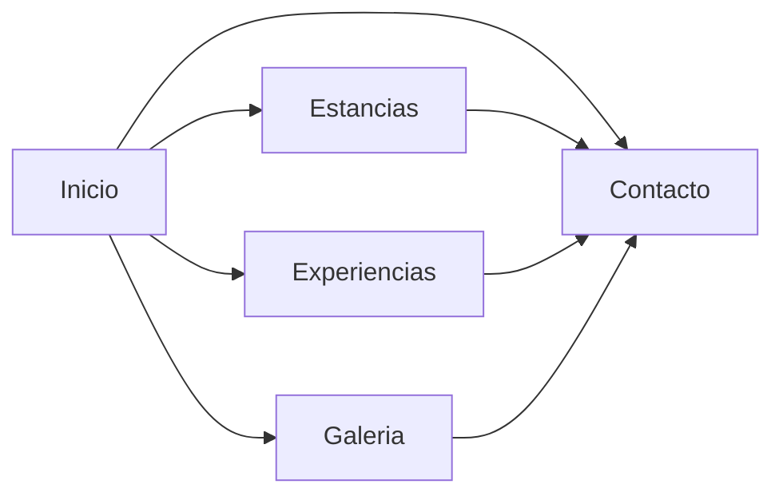

# Nuru Safari

Proyecto web de un hotel safari de lujo realizado con **HTML, CSS y JavaScript básico**.

[Ver la web](https://leandramorenoo.github.io/Safari/)

## Páginas

- Inicio
- Estancias
- Experiencias
- Galería
- Contacto

## Componentes

Se han creado y reutilizado componentes como:

- Header y menú desplegable
- Botones
- Cards de alojamientos y experiencias
- Formularios
- Galería de imágenes
- Footer

## JavaScript

Se han añadido funcionalidades interactivas utilizando JavaScript básico:

- **Menú desplegable:** apertura y cierre del menú mediante un botón.
- **Header dinámico:** cambio de estilo al hacer scroll.
- **Hero automático:** cambio de imágenes cada 1,8 segundos.
- **Galerías de Estancias y Galería:** apertura de imágenes en un modal. Se puede navegar con los botones o las flechas del teclado y cerrar con la X o Escape. Tab permite recorrer los botones del modal.
- **Pantalla de carga:** animación inicial en la página de Inicio.

## CSS y responsive

- Variables CSS y clases BEM.
- Efectos hover y animaciones al hacer scroll.
- Hero sticky en Galería y Experiencias.
- Scroll horizontal en algunas secciones de pantallas pequeñas.
- Imágenes optimizadas y carga diferida de imágenes secundarias.

## Navegación

## Cambios respecto al diseño

Se realizaron pequeños ajustes para adaptar el diseño a **tablet y móvil**, como cambios en los espacios, el tamaño de imágenes y vídeos, la distribución de algunos elementos y la galería responsive.
